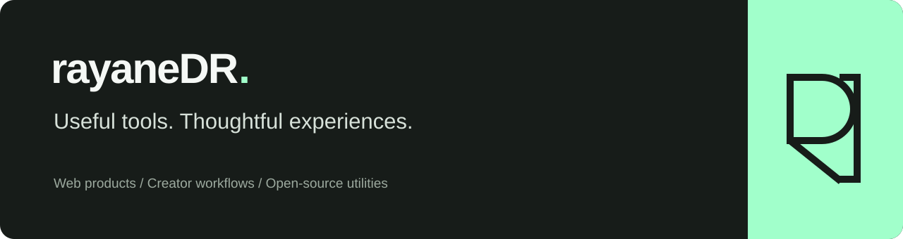

### Building small tools around real workflows.

I'm Rayane. I'm building practical web products for creators, with a focus on clear interfaces, useful motion, and the details that make a workflow easier.

Right now, I'm developing **ReviewLoop**: a lightweight way for independent video editors to collect timestamped feedback and keep client decisions attached to the right cut. It's in the prototype and validation stage.

#### What you'll find here

- **Web products** — focused tools built around a specific job.
- **Creator workflows** — experiments in video feedback, editing, and motion.
- **Small open-source utilities** — standalone tools with clear documentation, as they're ready to share.

#### Current work

| Project | What it does | Stage |
| :--- | :--- | :--- |
| ReviewLoop | Timestamped video feedback and version-specific review decisions | Local prototype · validating with editors |
| review-notes-csv | Turns video-review notes from JSON into spreadsheet-safe CSV | Built and tested · release preparation |

#### Working with

TypeScript · React · Vite · Node.js · Python · FFmpeg

I use AI tools as part of my workflow and verify the result with builds, tests, and hands-on review. The goal is useful software, not a long list of features.

---

**Have feedback or a workflow worth improving?** Open an issue on a relevant public project when it's available. I'm happy to hear what could work better.
